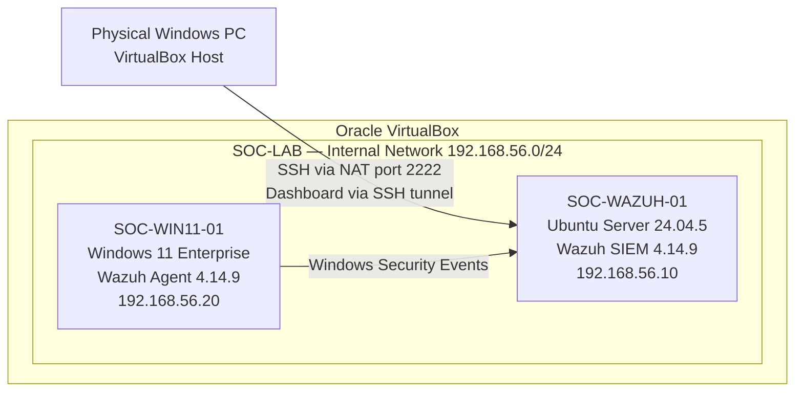
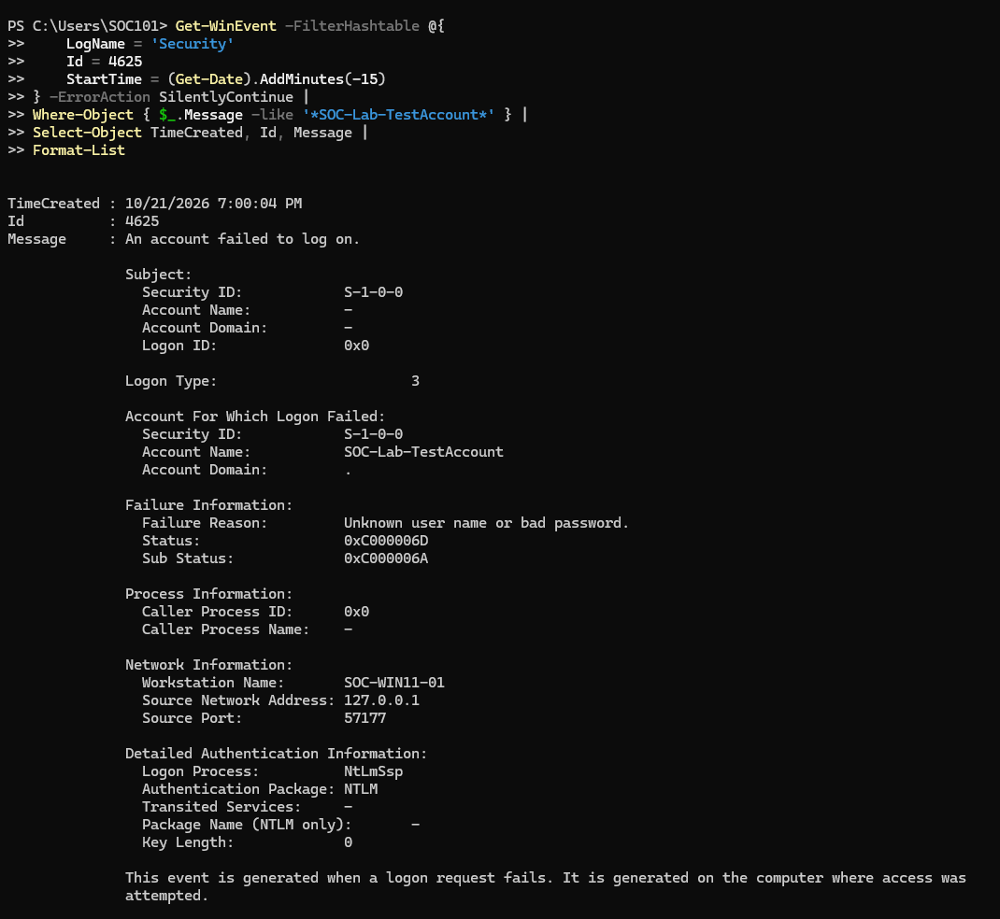
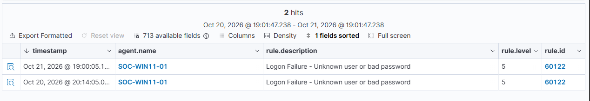

# Wazuh SOC Home Lab

## Project Overview

This project documents the deployment and operation of a virtual Security Operations Center (SOC) home lab using Wazuh SIEM, Ubuntu Server, Windows 11 Enterprise Evaluation, and Oracle VirtualBox.

The purpose of this lab is to develop and demonstrate practical cybersecurity skills, including SIEM deployment, endpoint monitoring, Windows Event Log analysis, security alert triage, incident investigation, and technical documentation.

The environment was built from scratch, including virtual networking, Linux server administration, Wazuh installation, Windows agent deployment, and controlled security event testing.

**Project Status:** In Progress — Core Infrastructure and Initial Security Investigation Completed

## Lab Architecture

| Component | Technology | Purpose |
|---|---|---|
| Hypervisor | Oracle VirtualBox | Host virtual lab machines |
| SIEM Server | Wazuh 4.14.9 on Ubuntu Server 24.04.5 LTS | Centralized security monitoring and analysis |
| Endpoint | Windows 11 Enterprise Evaluation | Generate and forward security events |
| SIEM Agent | Wazuh Agent 4.14.9 | Collect endpoint security telemetry |
| Log Source | Windows Event Logs | Provide authentication and system event data |
| Lab Network | VirtualBox Internal Network (SOC-LAB) | Isolated communication between virtual machines |
| Remote Administration | SSH with Ed25519 key authentication | Secure remote access to Ubuntu Server |

### Network Architecture Diagram

*Both virtual machines also use NAT-based adapters for external connectivity. The Wazuh dashboard is accessed through an SSH tunnel.*

### Network Configuration

| System | Hostname | Internal IP Address |
|---|---|---|
| Wazuh Server | SOC-WAZUH-01 | 192.168.56.10 |
| Windows Endpoint | SOC-WIN11-01 | 192.168.56.20 |

Both virtual machines use separate NAT-based adapters for external connectivity.

The Wazuh dashboard is accessed from the physical Windows host through an SSH local port-forwarding tunnel.

## Project Objectives

- Deploy and configure a functional Wazuh SIEM environment.
- Establish isolated virtual networking between monitored systems.
- Configure SSH remote administration using public-key authentication.
- Deploy and enroll a Windows 11 endpoint using the Wazuh agent.
- Collect and analyze Windows security events.
- Investigate Windows service configuration changes.
- Generate controlled failed-authentication events.
- Analyze Windows Event ID 4625 and corresponding Wazuh alerts.
- Validate event timestamps across the endpoint and SIEM.
- Document investigation procedures, findings, and lessons learned.

## Project Phases

| Phase | Description | Status |
|---|---|---|
| 1 | Virtual machine and Ubuntu Server setup | Completed |
| 2 | Virtual networking and SSH configuration | Completed |
| 3 | Wazuh installation and configuration | Completed |
| 4 | Windows 11 agent deployment | Completed |
| 5 | Security event simulation and investigation | Completed |
| 6 | Incident reporting and portfolio documentation | In Progress |

## Security Monitoring and Investigation

### Investigation 01 — Windows Failed-Logon Detection

**Windows Event ID:** 4625  
**Wazuh Rule ID:** 60122  
**Wazuh Alert Level:** 5  
**Endpoint:** SOC-WIN11-01  
**Classification:** Authorized Lab Simulation  
**Disposition:** Closed — Benign Activity

A controlled failed-authentication attempt was generated on the Windows 11 endpoint using a temporary local test account and an intentionally incorrect password.

Windows recorded Security Event ID 4625, and Wazuh successfully detected the event using Rule 60122, identifying an unknown username or incorrect password.

The investigation included analysis of:

- Target account and authentication failure details.
- Network logon type (Type 3).
- NTLM authentication.
- Source IP address (127.0.0.1 — local loopback).
- Windows authentication status and substatus codes.
- Wazuh rule classification and severity.

An initial timestamp discrepancy between Windows and Wazuh was also investigated. After correcting the Windows VM's time-zone configuration, a second controlled test confirmed consistent timestamp presentation between the endpoint and SIEM.

**Outcome:** Successfully generated, detected, investigated, and documented a Windows failed-authentication event.

[Read the Full Investigation Report](documentation/failed-logon-investigation.md)

### Detection Evidence

The following screenshots show the second controlled authentication test performed after correcting the Windows VM's time-zone configuration.

**Windows Security Event ID 4625 — October 21, 2026**

**Wazuh Rule 60122 — October 21, 2026**

The Windows event was recorded at 7:00:04 PM, and the corresponding Wazuh alert was displayed at 7:00:05 PM, demonstrating consistent timestamp presentation after the time-zone correction.

The original October 20 detection and its associated timestamp discrepancy are preserved in the [full investigation report](documentation/failed-logon-investigation.md).

## Additional Security Monitoring

### Windows Service Configuration Change

During initial endpoint monitoring, a Windows Service Control Manager Event ID 7040 was reviewed.

The event involved a change to the Background Intelligent Transfer Service (BITS) startup configuration.

The service state and startup mode were examined using PowerShell. The observed configuration was consistent with a stopped service configured for manual startup.

The cause of the change was not established, and no malicious activity was confirmed.

### Security Configuration Assessment

Wazuh performed an initial assessment using the CIS Windows 11 Enterprise Benchmark v3.0.0.

| Assessment Result | Count |
|---|---|
| Passed | 123 |
| Failed | 350 |
| Not Applicable | 9 |
| Reported Score | 26% |

These results represent the initial security configuration baseline and are not evidence of system compromise.

## Skills Demonstrated

- Wazuh SIEM deployment and administration
- Windows endpoint agent deployment and enrollment
- Windows Security Event Log analysis
- Security alert triage and investigation
- Authentication failure analysis
- Event correlation and timestamp validation
- Windows service monitoring
- Security Configuration Assessment interpretation
- VirtualBox network configuration
- Static IPv4 addressing and connectivity troubleshooting
- Windows Defender Firewall configuration
- Ubuntu Server administration
- SSH public-key authentication and port forwarding
- Technical documentation and evidence-based reporting

## Documentation

Detailed configuration procedures, troubleshooting notes, and investigation reports are available below.

| Document | Description |
|---|---|
| [Ubuntu Installation Troubleshooting](documentation/ubuntu-installation-troubleshooting.md) | Ubuntu installation issue, troubleshooting, and resolution |
| [Network Configuration](documentation/network-configuration.md) | Virtual networking, static IP addressing, firewall configuration, and SSH |
| [Wazuh Installation](documentation/wazuh-installation.md) | Wazuh SIEM deployment and service validation |
| [Windows Agent Deployment](documentation/windows-agent-deployment.md) | Windows endpoint enrollment and monitoring validation |
| [Failed-Logon Investigation](documentation/failed-logon-investigation.md) | Windows Event ID 4625 detection and SOC investigation |

## Screenshots

Screenshots are organized by project phase:

- [Phase 1 — Ubuntu Server Setup](screenshots/01-ubuntu-setup/)
- [Phase 2 — Network Configuration](screenshots/02-networking/)
- [Phase 3 — Wazuh Installation](screenshots/03-wazuh-installation/)
- [Phase 4 — Windows Agent Deployment](screenshots/04-agent-deployment/)
- [Phase 5 — Security Monitoring](screenshots/05-security-monitoring/)

## Future Development

Planned improvements include:

- Additional Windows security event simulations.
- Investigation of authentication patterns and suspicious activity.
- Expanded SIEM alert analysis and detection testing.
- Additional SOC investigation reports.
- Further endpoint security configuration review.

## Disclaimer

This project is intended for educational and professional development purposes.

All security testing is performed within a controlled virtual lab using systems owned and administered for the exercise.

The documented alerts represent authorized testing or observed system activity and should not be interpreted as evidence of an actual security compromise.

